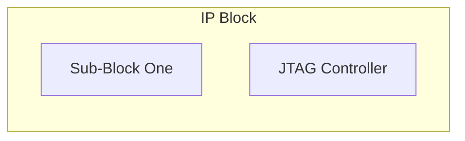
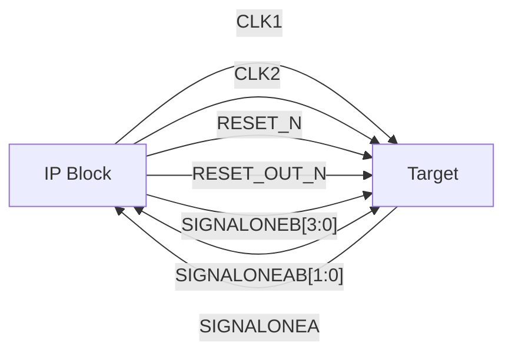
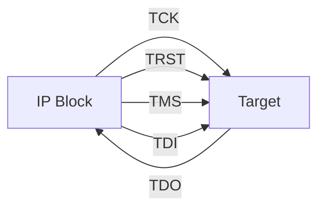

<!-- =====================================================================
  SYNOPSYS HAPS GROUP - IP BLOCK TECHNICAL REFERENCE MANUAL (TRM) TEMPLATE
  Authoring Guidelines for DITA XML Automation:
  1. Every file MUST have EXACTLY ONE level-1 heading (#). Use as many sub-headings (##, ###, ####) as needed without skipping levels.
  2. Always include at least one introductory sentence under EVERY heading before starting a sub-heading, table, or diagram.
  3. Do NOT use inline HTML tags (e.g., <br>, <table>, <font>).
  4. Wrap register names, addresses, signals, and bit values in backticks (`).
  5. Diagrams: You can use EITHER inline ```mermaid code blocks OR standard image links .
  Note: Standard Preface and Signal Conventions are injected automatically by the DITA pipeline.
====================================================================== -->

# [IP Block Name] Technical Reference Manual (TRM)

Provide a brief one-sentence summary of the IP Block and its primary role within the HAPS system.

## Change History

The following table records the revision history of this document.

| Date | Version | Change |
| :--- | :--- | :--- |
| 23 Oct 2026 | 0.1 | Initial Draft |

## Introduction

This document seeks to provide a standard way to describe IP designs developed by the HAPS group, and enable re-use across the group, so that different teams within the group can integrate IP blocks in their designs easily.

## Functional Overview

This chapter describes the core functionality of the IP block. An overview is provided first (including a high-level block diagram), followed by a detailed functional description.

<!-- You can define diagrams using Mermaid (as shown below) OR link an image:  -->



### Functional Description

Provide a detailed functional description of the IP block here. Multiple paragraphs or sub-sections can be used if the complexity of the IP block warrants it.

### System Considerations

Describe how this IP block fits into a larger system and highlight any constraints, dependencies, or requirements the integrator needs to be aware of when integrating the IP block.

### System Connectivity

Describe how the IP block is connected within a larger system and how its interfaces interact with external components.


## Programmer's Model

This chapter describes the programmer's model of the IP block, including the memory map, registers, and how the IP block should be configured and programmed.

### About the programmer's model

Describe general considerations about the programmer's model here (for example, the initiator/responder model used, endianness, or access width constraints).

### Programming the IP Block

Describe the operational sequence required to program the IP block to achieve the desired functionality (e.g., initialization steps, which registers should be accessed, and in what order).

### Summary of IP Block's Registers

The following table lists the memory-mapped registers available in the IP block.

| Name | Base Offset | Type | Reset | Description |
| :--- | :--- | :--- | :--- | :--- |
| `IP Block Status` | `0x0000` | `RO` | `0x0` | Status of the IP Block |
| `IP Block Clear` | `0x0004` | `WO` | `-` | Clear IP Block |

### Register Descriptions

This section provides detailed bit-level descriptions for each register in the IP block.

<!-- Note for Engineers: You do NOT need to draw the visual 32-bit register bar. 
     Simply fill out the Bit table below using [MSB:LSB] or [Bit] notation, 
     and the DITA pipeline will generate the 32-bit visual diagram automatically. -->

#### IP Block Status (`0x0000`)

The `IP Block Status` register with address offset of `0x0000` is read-only and shows the current status of the IP Block.

**Register bit assignments:**

| Bit | Name | Function |
| :--- | :--- | :--- |
| `[31:2]` | `-` | Read undefined |
| `[1:0]` | `Internal Status` | Status of the IP Block |

**Internal Status values:**

| Bit value of Internal Status | Status Description |
| :--- | :--- |
| `2'b00` | Status zero |
| `2'b01` | Status one |
| `2'b10` | Status two |
| `2'b11` | Status three |

#### IP Block Clear (`0x0004`)

The `IP Block Clear` register with address offset of `0x0004` is write-only and is used to clear the IP Block status.

**Register bit assignments:**

| Bit | Name | Function |
| :--- | :--- | :--- |
| `[31:1]` | `-` | Reserved, write as zero |
| `[0]` | `Clear` | Write `1'b1` to clear the IP Block status |

### Other Functional Description

Describe any additional programming or operational functionality not covered by the standard register descriptions.

### Interrupt Requests

Describe how interrupt requests are generated, masked, and cleared by the IP block.

## Signal Description

This chapter lists and describes all external input, output, and bidirectional signals of the IP block, grouped by interface.

### Clocks and Resets

The following table describes the clock and reset signals required by the IP block.

| Name | Type | Source/Destination | Description |
| :--- | :--- | :--- | :--- |
| `CLK1` | Input | Sub-Block One | Clock one description |
| `CLK2` | Input | Sub-Block Two | Clock two description |
| `RESET_N` | Input | All Sub-Blocks | System Reset Active Low |
| `RESET_OUT_N` | Output | Downstream system | Reset Output Active Low |
| `TRST` | Output | JTAG | JTAG Reset Active High |
| `TCK` | Output | JTAG | JTAG Clock |

### Group One Signals

The following table describes the signals belonging to the Group One interface.

| Name | Type | Source/Destination | Description |
| :--- | :--- | :--- | :--- |
| `SIGNALONEA` | Input | Sub-Block One | Action one a |
| `SIGNALONEB[3:0]` | Output | Sub-Block One | Action one b |
| `SIGNALONEAB[1:0]` | InOut | Sub-Block One | Action one ba |

### JTAG Signals

The following table describes the JTAG interface signals.

| Name | Type | Source/Destination | Description |
| :--- | :--- | :--- | :--- |
| `TDI` | Output | JTAG | Test Data In |
| `TDO` | Input | JTAG | Test Data Out |
| `TMS` | Output | JTAG | Test Mode Select |

## Interface Timing and Signals

This chapter illustrates the signal connections and timing waveforms for the IP block interfaces.

### Group One Interface

This section describes the connection topology and timing requirements for the Group One interface.

#### Signals

Describe the signal interaction and handshaking protocol for the Group One interface.



#### Timing Diagram

Provide the timing explanation and waveform diagram for the Group One interface.


### JTAG Interface

This section describes the connection topology and timing requirements for the JTAG interface.

#### Signals

Describe the signal interaction for the JTAG interface.



#### Timing Diagram

Provide the timing explanation and waveform diagram for the JTAG interface.


## Glossary

The following table defines the abbreviations and technical terms used in this document.

| Term | Definition |
| :--- | :--- |
| **HAPS** | High-performance ASIC Prototyping System |
| **IP** | Intellectual Property |
| **JTAG** | Joint Test Action Group |
| **RO / WO / RW** | Read-Only / Write-Only / Read-Write |
| **TRM** | Technical Reference Manual |